# Identitas

| No. | Nama                          | NRP        |
| --- | ----------------------------- | ---------- |
| 1   | Muhammad Syadzili Abdul Muhyi | 5027251030 |
| 2   | Bambang Nasarillah Kurniawan  | 5027251110 |

# Pengerjaan


Di sini kami membuat topologi jaringan sesuai dengan yang diminta oleh soal, yaitu dengan menggunakan beberapa konfigurasi berikut:

- **NAT1**: Digunakan sebagai penghubung jaringan internal dengan jaringan eksternal.
    
- **Jichi**: Digunakan sebagai node pusat yang menghubungkan NAT1 dengan beberapa cabang jaringan internal.
    
- **Switch1**: Menghubungkan node Jichi dengan Shoko, Utahime, dan Gojo.
    
- **Switch2**: Menghubungkan Jichi dengan Switch3 dan Switch9.
    
- **Switch3**: Menghubungkan jaringan client Itodori dan Kushiguro.
    
- **Switch9**: Menghubungkan jaringan client Zenin dan Okukatsu.
    
- **Switch4**: Menghubungkan Jichi dengan Switch5 dan Switch8.
    
- **Switch5**: Menghubungkan jaringan client Kusakabe dan Ino.
    
- **Switch8**: Menghubungkan jaringan client Miwa dan Kugisaki.
    
- **Switch6**: Menghubungkan Jichi dengan Switch7 dan Switch10.
    
- **Switch7**: Menghubungkan Geto serta client Maki, Panda, Nanami, dan Kirara, termasuk satu client lain yang labelnya kurang terbaca pada gambar.
    
- **Switch10**: Menghubungkan node Tengen dengan client Yaga dan Inumaki.
    

Topologi ini dirancang untuk menghubungkan seluruh node dan client melalui beberapa cabang jaringan. Komunikasi antarnode bergantung pada konfigurasi alamat IP, subnet, gateway, dan routing yang diterapkan.

1. Ketika Curtain menutup Shibuya, jalur komunikasi antar zona Jujutsu High terputus. Pulihkan konektivitas dasar dengan mengonfigurasi jichi: eth0 memperoleh WAN dari NAT, sedangkan eth1–eth4 menjadi gateway Network 1–4 sesuai tabel pemetaan. Aktifkan IPv4 forwarding dan source NAT, lalu tetapkan IP statis host infrastruktur sesuai tabel spesifikasi. Buktikan konektivitas setiap host ke gateway dan akses eksternal dari host yang relevan.

konteksnya gini: Infrastruktur terbagi menjadi 4 jaringan: Network 1 (DMZ), Network 2 (Divisi A), Network 3 (Divisi B), dan Network 4 (Data Center). Node jichi bertindak sebagai router sentral yang menghubungkan keempat jaringan internal tersebut sekaligus menjadi pintu gerbang (Gateway) menuju internet (WAN).

objektif yg harus dilakukan:
- Mengonfigurasi IP statis pada interface eth1 hingga eth4 di jichi sebagai gateway masing-masing subnet.
- 
-Mengaktifkan fitur IP Forwarding dan Source NAT (Masquerade) agar paket dari jaringan internal dapat diteruskan ke internet.
-Menetapkan IP statis pada seluruh host server di Network 1 dan Network 4

**Jalankan `soal1.sh` dan `verify1.sh` yang ada di `jichi`**

script soal1.sh mengubah parameter kernel net.ipv4.ip_forward menjadi nilai 1 agar jichi dapat mengeksekusi proses routing paket antar-subnet. Perintah iptables -t nat -A POSTROUTING -o eth0 -j MASQUERADE menginstruksikan sistem untuk membungkus (masquerade) IP internal dengan IP publik saat melewati antarmuka eth0 menuju internet. Pengalokasian IP statis pada server dilakukan secara paralel melalui API console. 

Berdasarkan pengujian verify1.sh, parameter IP forwarding dan Masquerade telah terkonfirmasi aktif. Pengujian ICMP (ping) dari jichi ke seluruh alamat IP host server (termasuk DNS, Load Balancer, dan Database) menunjukkan status berhasil, yang menandakan routing internal beroperasi normal. Pengecekan koneksi ke 8.8.8.8 juga memberikan reply, membuktikan bahwa topologi internal sudah memiliki akses ke eksternal/internet.

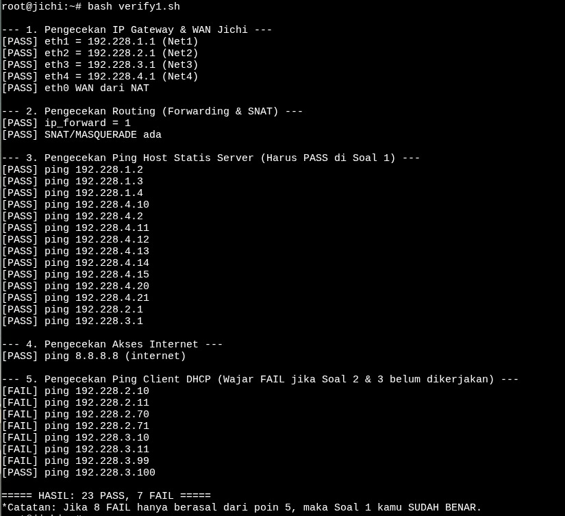
2. Tengen, penjaga pusat distribusi di Data Center, harus mengambil alih pengalokasian alamat bagi wilayah yang membutuhkan konfigurasi dinamis. Konfigurasikan isc-dhcp-server pada [PREFIX IP].4.10. Deklarasikan Network 4 ([PREFIX IP].4.0/24) sebagai subnet lokal tanpa pool dinamis, lalu siapkan scope DHCP untuk Network 2 ([PREFIX IP].2.0/24) dan Network 3 ([PREFIX IP].3.0/24). Validasi konfigurasi dan pastikan service aktif tanpa error “No subnet declaration”.

konteks soalnya : Node tengen berada di dalam Network 4 (Data Center) yang seluruh perangkat infrastrukturnya menggunakan alokasi IP statis. Meskipun tidak memberikan IP untuk jaringannya sendiri, tengen ditugaskan sebagai pelayan DHCP terpusat untuk membagikan IP secara dinamis kepada klien di Divisi A (Network 2) dan Divisi B (Network 3).

objektif yang harus dilakukan:
Menginstal paket isc-dhcp-server pada node tengen dan mengarahkan service untuk mendengarkan permintaan pada antarmuka eth0.
Mendeklarasikan Network 4 sebagai subnet lokal di konfigurasi DHCP tanpa memberikan range pool, yang bertujuan murni untuk memenuhi syarat operasional service dan menghindari error.
Menyiapkan scope atau blok subnet untuk Network 2 dan Network 3 agar siap melayani permintaan alokasi alamat dari luar jaringan.

**Jalankan `soal2.sh` dan `verify2.sh` pada tengen**

Script membatasi isc-dhcp-server hanya pada antarmuka IPv4 eth0. Pada file dhcpd.conf, blok subnet 192.228.4.0 sengaja dideklarasikan tanpa parameter pool { range ... }. Deklarasi subnet tempat interface eth0 bernaung ini adalah syarat mutlak dari sistem ISC DHCP; tanpanya, service akan menolak untuk start dan memunculkan galat "No subnet declaration for eth0". Subnet untuk Network 2 dan 3 juga dideklarasikan beserta pool dinamis sementara (berakhiran .100 - .200) sebagai ruang alokasi dasar.

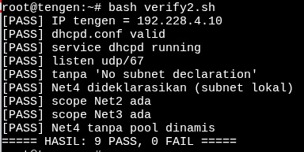

Berdasarkan verifikasi dari verify2.sh, service DHCP server sukses berjalan (running) dan secara aktif mendengarkan (listen) pada port UDP 67. Pengujian sintaks menggunakan dhcpd -t memberikan status valid, dan pembacaan log memastikan bahwa pesan galat "No subnet declaration" telah berhasil diatasi melalui deklarasi Network 4 yang tepat sasaran.

3. Permintaan alamat dari Divisi A dan Divisi B tidak dapat menyeberangi subnet secara langsung. Konfigurasikan jichi sebagai DHCP Relay menuju tengen ([PREFIX IP].4.10), menggunakan eth2 untuk Network 2 dan eth3 untuk Network 3. Buktikan bahwa client dari kedua subnet berhasil memperoleh lease melalui relay.

konteks soal no 3 : 
Protokol DHCP beroperasi menggunakan paket pencarian berbasis broadcast (DHCP Discover). Secara default, perangkat router (jichi) akan memblokir paket broadcast agar tidak menyeberang ke jaringan lain. Akibatnya, client di Network 2 (Divisi A) dan Network 3 (Divisi B) tidak akan pernah bisa menjangkau DHCP Server tengen yang terisolasi di Network 4 tanpa adanya agen perantara (Relay Agent).
Objektif untuk penyelesaian soal ini : 
- Menginstal paket isc-dhcp-relay pada router jichi.
- Mengonfigurasi jichi untuk menangkap (listen) paket broadcast DHCP dari antarmuka Divisi A dan B, lalu meneruskannya secara unicast langsung ke IP tengen (192.228.4.10).

**Jalankan `soal3.sh` dan `verify3,sh` di jichi**

Script melakukan instalasi layanan isc-dhcp-relay. Pada file konfigurasinya, variabel SERVERS diisi dengan IP milik tengen sebagai tujuan akhir penerusan paket. Variabel INTERFACES diisi dengan eth2 (jalur masuk Network 2) dan eth3 (jalur masuk Network 3). Pencantuman eth4 sangat krusial; antarmuka ini wajib didaftarkan agar jichi dapat menerima paket balasan (DHCP Offer dan DHCP ACK) dari tengen untuk dikembalikan lagi ke client peminta. Setelah itu, service di-restart agar aturan baru diterapkan.

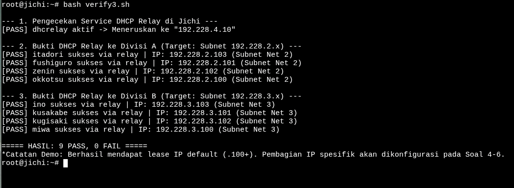

Hasil eksekusi verify3.sh mengonfirmasi bahwa service dhcrelay telah beroperasi dan mem- forward paket ke 192.228.4.10. Pembacaan IP secara langsung dari antarmuka seluruh client di Divisi A (itadori, fushiguro, zenin, okkotsu) dan Divisi B (ino, kusakabe, miwa, kugisaki) menunjukkan bahwa mereka sukses mendapatkan lease IP dari blok pool default sementara (berakhiran .100 ke atas). Keberhasilan perolehan IP ini adalah bukti mutlak bahwa paket negosiasi DHCP telah sukses difasilitasi menyeberangi subnet oleh jichi.

4. Agar tim Dev dan Support di Divisi A menerima jatah alamat yang berbeda, atur dua pool DHCP pada Network 2. Tetapkan Pool 1 ([PREFIX IP].2.10–[PREFIX IP].2.35) untuk itadori dan fushiguro, serta Pool 2 ([PREFIX IP].2.70–[PREFIX IP].2.95) untuk zenin dan okkotsu. Rentang [PREFIX IP].2.36–[PREFIX IP].2.69 tidak boleh dialokasikan. Karena seluruh client berada pada subnet yang sama, gunakan DHCP class berdasarkan MAC Address atau Client ID untuk memisahkan kedua kelompok.

konteks : Meskipun klien itadori, fushiguro, zenin, dan okkotsu secara fisik dan logis berada di dalam satu broadcast domain atau subnet yang sama yaitu Divisi A (Network 2), tim administratif menuntut pemisahan segmen IP (antara tim Dev dan Support) untuk memudahkan pemantauan dan pengelolaan resource. Pemisahan pool dalam satu subnet ini membutuhkan identifikasi tingkat perangkat keras (hardware layer).

objektif yang harus dilakukan : 
- Membuat class DHCP pada server tengen berdasarkan pencocokan MAC Address (hardware ethernet).
- Mengelompokkan MAC Address itadori dan fushiguro ke dalam Pool 1, dan MAC Address zenin serta okkotsu ke dalam Pool 2.
- Mengamankan rentang IP dari .36 hingga .69 dengan tidak mendeklarasikannya di dalam pool mana pun agar tidak bisa disewakan (lease).

**Jalankan soal4.sh dan verify4.,sh di client tengen**

Script soal4.sh menetapkan MAC Address asli klien ke dalam variabel, kemudian menginjeksikannya ke dalam konfigurasi /etc/dhcp/dhcpd.conf. Arahan match hardware digunakan untuk membentuk kelas klasifikasi. Penggunaan instruksi allow members of di dalam masing-masing blok pool memastikan bahwa alokasi IP .10-.35 dan .70-.95 terkunci secara eksklusif hanya untuk perangkat dengan MAC Address yang telah didaftarkan di blok subclass. Rentang IP .36 hingga .69 secara otomatis terlarang (unassigned) karena tidak dideklarasikan di blok mana pun.

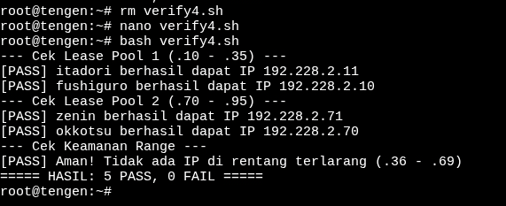

Berdasarkan hasil pengujian verify4.sh, DHCP Server sukses membaca identitas MAC Address dan memberikan IP secara terarah. Klien itadori dan fushiguro secara konsisten terdeteksi mendapatkan IP di dalam rentang 192.228.2.10 - .35 (Pool 1), sementara zenin dan okkotsu dialokasikan ke rentang 192.228.2.70 - .95 (Pool 2). Pemeriksaan log leases (Keamanan Range) juga memastikan keamanan dengan tidak ditemukannya pencatatan peminjaman IP di wilayah terlarang .36 - .69.

5. Setiap tim lapangan memiliki durasi operasi yang berbeda. Pada Network 3, berikan short lease 30 menit (1800 detik) kepada ino dan kusakabe, serta long lease 12 jam (43200 detik) kepada miwa. Gunakan pool short lease [PREFIX IP].3.10–[PREFIX IP].3.89 dan pool long lease [PREFIX IP].3.100–[PREFIX IP].3.199. Sesuaikan default-lease-time dan max-lease-time untuk setiap kelas client. Berikan pula DHCP options berupa DNS [PREFIX IP].1.2 dan [PREFIX IP].1.3, serta domain-search xxxx.com.

Konteks: Tim lapangan di Divisi B (Network 3) memiliki kebutuhan peminjaman IP yang tidak seragam akibat siklus operasional yang variatif. Penyesuaian durasi peminjaman (lease time) diperlukan agar tabel alokasi jaringan tetap efisien dan IP yang tidak lagi digunakan dapat segera didaur ulang. Selain itu, diperlukan otomatisasi pembagian alamat server DNS agar klien tidak perlu melakukan pengaturan nama domain secara manual.

Objektif:
- Menerapkan DHCP classing pada tengen untuk klien di Divisi B berdasarkan MAC Address mereka.
- Mengonfigurasi dua pool berbeda di dalam subnet 192.228.3.0/24: satu pool dengan durasi peminjaman singkat (1800 detik) dan satu pool dengan durasi peminjaman panjang (43200 detik).
- Menginjeksikan parameter options DHCP berupa DNS dan domain-search ke seluruh konfigurasi klien.

**Jalankan soal5.sh dan verify5.sh di tengen**

Deklarasi option jaringan (seperti domain-name-servers dan domain-name) diletakkan pada level subnet agar konfigurasinya diturunkan ke seluruh kelas di bawahnya. Nilai lease waktu dimodifikasi secara spesifik di dalam masing-masing blok pool melalui perintah default-lease-time dan max-lease-time (1800 detik untuk shortlease, 43200 detik untuk longlease). Penetapan ini akan meng- override konfigurasi waktu peminjaman global server khusus untuk anggota kelas tersebut.

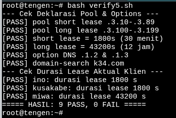

Berdasarkan hasil pengujian verify5.sh, struktur blok konfigurasi telah dideklarasikan dengan benar. Validasi langsung terhadap berkas log leases (/var/lib/dhcp/dhcpd.leases) membuktikan bahwa perhitungan selisih antara stempel waktu peminjaman (starts) dan kedaluwarsa (ends) menghasilkan angka yang akurat. Klien ino dan kusakabe secara efektif terbatasi pada durasi 1800 detik, sementara miwa mendapatkan perpanjangan masa aktif hingga 43200 detik. Sistem pencarian domain k34.com dan resolusi DNS juga terbukti telah didistribusikan.

6. Kugisaki ditetapkan sebagai personel VIP yang harus mempertahankan alamat yang sama setiap kali terhubung. Buat DHCP static lease berdasarkan MAC Address client tersebut dengan fixed address [PREFIX IP].3.99. Pastikan alamat ini berada di luar seluruh pool dinamis, validasi konfigurasi server, lalu renew lease pada client. Buktikan bahwa alamat yang diterima sesuai dengan reservasi.

Pada soal ini, Kugisaki harus mendapatkan IP yang sama setiap kali terhubung ke jaringan. Karena itu, dibuat DHCP static lease berdasarkan MAC Address Kugisaki dengan IP 192.228.3.99. IP tersebut juga harus berada di luar rentang IP yang dibagikan secara dinamis.

**Jalankan script soal6.sh di tengen kemudian relay6.sh di jichi dan kugisaki**

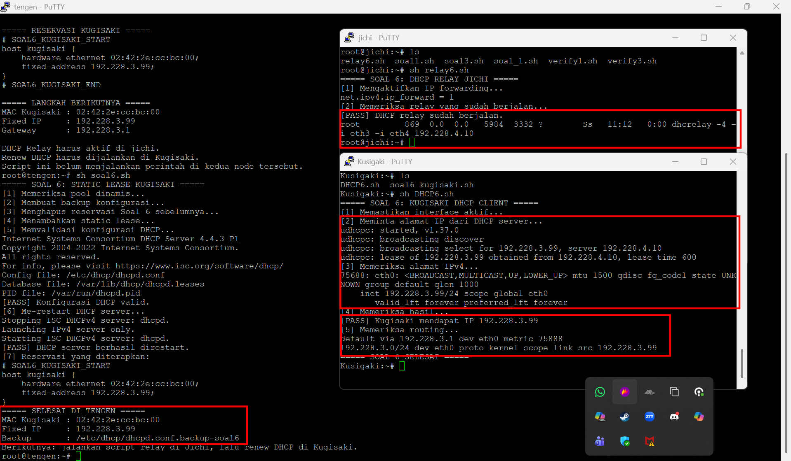

Reservasi IP berhasil dikonfigurasi di Tengen, sedangkan Jichi berfungsi meneruskan permintaan DHCP dari Kugisaki ke server. Setelah melakukan renew DHCP, Kugisaki berhasil mendapatkan IP 192.228.3.99 sesuai dengan reservasi yang dibuat.

7. Setelah aturan alokasi diterapkan, pastikan setiap client menerima konfigurasi jaringan sesuai wilayahnya: subnet mask 255.255.255.0 (/24), gateway dan broadcast address yang benar, DNS [PREFIX IP].1.2 serta [PREFIX IP].1.3, dan domain-search yang ditentukan. Periksa IP address dan routing seluruh client Divisi A dan Divisi B, kemudian cocokkan lease dengan /var/lib/dhcp/dhcpd.leases pada tengen. Pastikan tidak ada alamat yang bertabrakan atau berada di luar kebijakan pool.

Dilakukan pengujian DHCP untuk memastikan setiap klien mendapatkan IP sesuai dengan pembagian jaringan yang telah ditentukan. Pengujian dilakukan dengan memeriksa DHCP relay di Jichi, mencoba mendapatkan IP dari masing-masing klien, serta mengecek gateway, subnet mask, DNS, dan domain-search. Hasilnya kemudian dicocokkan dengan catatan lease DHCP di Tengen. Screenshot berikut menunjukkan proses dan hasil pengujian tersebut.

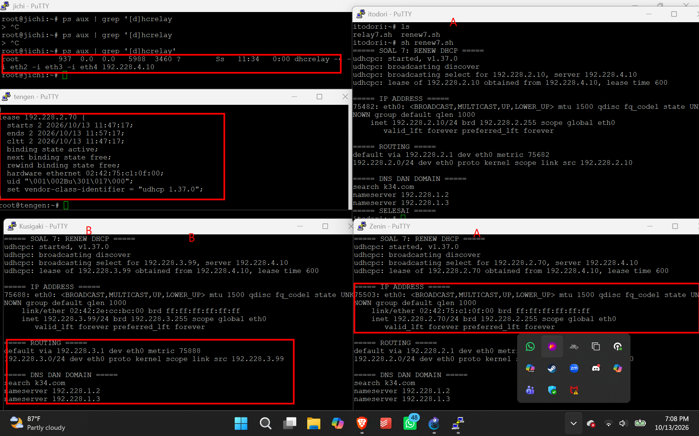

Berdasarkan pengujian yang telah dilakukan, Itodori berhasil mendapatkan IP 192.228.2.10, Zenin mendapatkan IP 192.228.2.70, dan Kugisaki mendapatkan IP tetap 192.228.3.99. Konfigurasi jaringan pada klien yang diuji juga menunjukkan gateway, subnet mask, dan DNS sesuai dengan konfigurasi yang diterapkan. Hasil lease di Tengen menjadi bukti bahwa permintaan IP dari klien berhasil diproses oleh server DHCP

8. Sebelum Curtain dibuka kembali, buktikan bahwa proses pemberian alamat berjalan sesuai protokol. Lakukan packet capture saat salah satu client Network 2 atau Network 3 meminta lease baru. Gunakan tcpdump pada tengen atau jalur menuju Data Center untuk menunjukkan urutan DHCPDISCOVER → DHCPOFFER → DHCPREQUEST → DHCPACK. Identifikasi alamat server, alamat yang diberikan, lease time, dan field giaddr. Pastikan nilai giaddr sesuai dengan interface jichi 

Untuk mengeceknya kita harus menjalankan script command 
```
tcpdump -ni eth0 -vvv -s 0 -l 'udp port 67 or udp port 68'
```
ditengen kemudian menggu 
lalu 
```
udhcpc -i eth0 -n -q -t 5 -T 3
```
di otodori

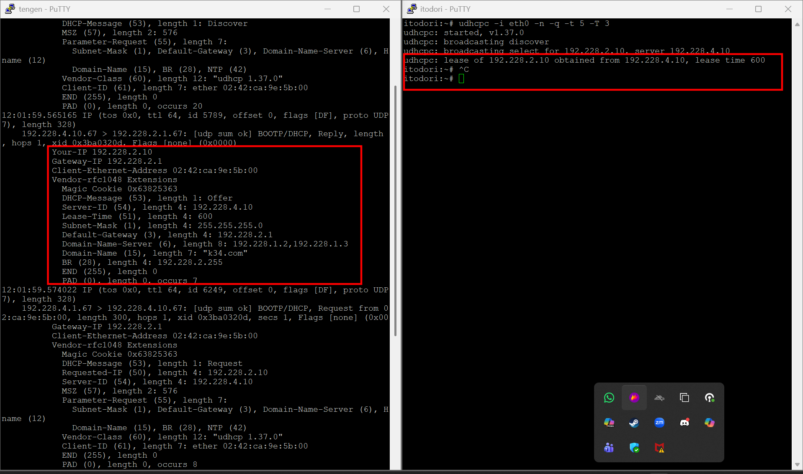

| No. | Informasi yang Diverifikasi              | Hasil                               |
| --- | ---------------------------------------- | ----------------------------------- |
| 1   | DHCPDISCOVER                             | Ada, pukul 12:01:58                 |
| 2   | DHCPOFFER                                | Ada, pukul 12:01:59                 |
| 3   | DHCPREQUEST                              | Ada, pukul 12:01:59                 |
| 4   | DHCPACK                                  | Ada, pukul 12:01:59                 |
| 5   | Alamat server DHCP                       | 192.228.4.10                        |
| 6   | Alamat IP yang diberikan                 | 192.228.2.10                        |
| 7   | Lease time                               | 600 detik                           |
| 8   | Field giaddr                             | 192.228.2.1                         |
| 9   | Kesesuaian giaddr dengan interface Jichi | Sesuai dengan eth2 (192.228.2.1/24) |

9. Sebuah gangguan memutus jalur relay dan membuat permintaan alamat tidak sampai ke Data Center. Hentikan service DHCP Relay pada jichi, lalu paksa salah satu client di Network 2 atau Network 3 meminta lease baru dan catat gejalanya. Pulihkan service relay, ulangi permintaan DHCP, lalu buktikan bahwa client kembali memperoleh alamat dari pool yang benar dengan gateway semula.

Soal ini meminta kita mencoba menghentikan DHCP Relay di jichi untuk melihat apa yang terjadi ketika client meminta IP baru, lalu mengaktifkannya kembali untuk memastikan DHCP berfungsi normal.

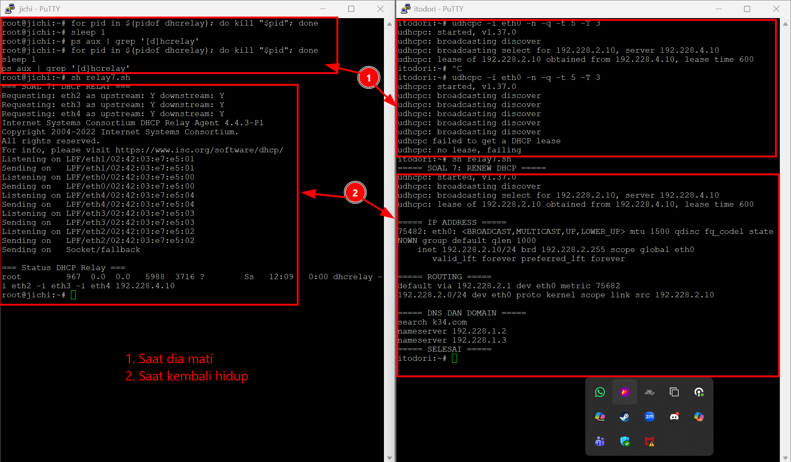

Dari gambar tersebut, terlihat bahwa saat DHCP Relay dihentikan, permintaan IP dari client tidak sampai ke DHCP Server. Setelah relay diaktifkan kembali, client bisa mendapatkan IP dari pool yang sesuai dengan jaringannya dan tetap menggunakan gateway semula.

10. Setelah gangguan Shibuya tertangani, pastikan pemulihan bertahan setelah restart. Aktifkan autostart DHCP Server pada tengen dan DHCP Relay pada jichi, lalu restart kedua node. Verifikasi status layanan, IP, gateway, lease, dan konektivitas client Network 2–3. Pastikan kebijakan Pool 1, Pool 2, short lease, long lease, dan fixed address tetap berlaku.

**Cukup jalankan saja script yang ada**

11. Utahime dan Shoko ditugaskan membangun sistem penamaan domain resmi agar seluruh pos tidak perlu menghafal alamat IP mentah. Konfigurasikan BIND9 pada utahime sebagai DNS Master dan shoko sebagai DNS Slave untuk mengelola domain jujutsu. xxxx.com. Atur SOA record, NS delegasi untuk kedua server, dan terapkan allow-transfer dari Master ke Slave. Pastikan file zona berhasil tersinkronisasi otomatis ke shoko saat nomor serial di utahime dinaikkan, lalu buktikan dengan melakukan query dig ke kedua server dari salah satu client.

Konteks: Node worker di Data Center (Network 4) dibagi menjadi dua kelompok: Frontend (maki, panda) dan Backend API (nanami, todo, kirara). Demi keamanan, manajemen lalu lintas, dan pencegahan eksploitasi, client tidak diizinkan untuk mengakses IP atau domain worker secara langsung. Trafik menuju Frontend wajib melewati public proxy (gojo), sedangkan trafik API wajib melewati Internal Load Balancer (geto).
Objektif:
- Menginstalasi web server Nginx dan PHP-FPM terintegrasi ekstensi mysqli pada seluruh node worker.
- Menyajikan skrip PHP identitas peladen (hostname) untuk worker frontend, dan skrip pencatatan log (berformat JSON) yang menembak database MariaDB di yaga untuk worker API.
- Menerapkan Virtual Host Nginx yang hanya merespons domain resmi (jujutsu.k34.com atau api.jujutsu.k34.com), dan menutup paksa koneksi (kode 444) untuk host IP mentah.
- Menerapkan blokade (Access Control List) pada Nginx: frontend hanya menerima IP 192.228.1.4, dan API hanya menerima dari IP 192.228.4.2 (geto).

**Jalankan soal_11.sh di uthanime dan shoko kemudian verify11.sh di kusakabe**

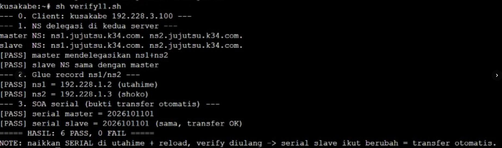

Verifikasi dilakukan dari dua sudut pandang (Client dan Proxy). Pengujian dari sisi client (seperti kusakabe) menghasilkan validasi sukses pada status penolakan, dibuktikan dengan kode error HTTP 403 (Forbidden) atau 000 (Connection Refused). Ini mengonfirmasi bahwa penembakan langsung dari luar tidak diizinkan. Pengujian dari sisi proxy (geto) menghasilkan kode HTTP 200 OK yang menandakan koneksi sah. Status balasan db_ok=true pada JSON dari worker API memastikan koneksi dan proses penetrasi data log dari PHP ke dalam database MariaDB di node yaga sukses dilakukan.

12. Peta domain harus memetakan pintu masuk utama dan tetap bisa mencari alamat di luar kawasan Shibuya. Pada utahime, buat A record jujutsu.xxxx.com yang mengarah ke gojo, serta CNAME www yang merujuk ke domain utama tersebut. Buat pula Reverse DNS (zona PTR) untuk melacak IP gojo kembali ke domain resminya, dan aktifkan fitur DNS Forwarder pada BIND9 mengarah ke IP gateway internet (192.168.122.1). Uji dari client dengan dig untuk mengecek CNAME, PTR, dan buktikan client tetap bisa melakukan ping ke domain internet seperti google.com.

Konteks:
Node gojo bertindak sebagai public reverse proxy (pintu masuk utama) dari luar yang menjembatani akses ke server internal. Klien dan pengguna internet perlu diarahkan ke gojo setiap kali mengakses domain utama atau subdomain www. Selain itu, untuk menjaga fungsi akses internet (browsing) klien dari dalam jaringan internal, DNS Server lokal perlu dikonfigurasi untuk melemparkan (forward) permintaan resolusi nama domain publik (seperti google.com) ke gateway eksternal.
Objektif:
- Menambahkan A Record untuk memetakan domain utama (jujutsu.k34.com) ke IP gojo (192.228.1.4).
- Menambahkan CNAME Record agar permintaan ke [www.jujutsu.k34.com](https://www.jujutsu.k34.com) secara otomatis dialihkan ke domain utama (sehingga bermuara juga ke gojo).
- Mendeklarasikan Reverse Zone (PTR) untuk memetakan alamat IP .1.4 kembali menjadi nama domain jujutsu.k34.com.
- Menambahkan DNS Forwarders menuju 192.168.122.1 agar server bisa mengenali domain publik.

**Jalankan script soal12.sh di client utahime kemudian verify.sh di kusakabe** 

Untuk pencarian reverse, zona baru dengan format kebalikan IP (1.228.192.in-addr.arpa) didaftarkan ke dalam named.conf.local lengkap dengan izin transfer data ke DNS Slave. Opsi forwarders diaktifkan di named.conf.options menunjuk ke IP gateway internet. Pada file zona db.jujutsu.k34.com, simbol @ (mewakili nama zona itu sendiri) dipetakan ke IP 192.228.1.4, sedangkan www dikonfigurasi sebagai Canonical Name (CNAME) dari domain utama. Pada fail db.rev1, angka oktet terakhir 4 dipetakan ke domain. Hal penting yang dicatat adalah serial number zona pada utahime sengaja dinaikkan (menjadi 2026101201) agar shoko otomatis memicu proses zone transfer setelah konfigurasi baru disimpan.

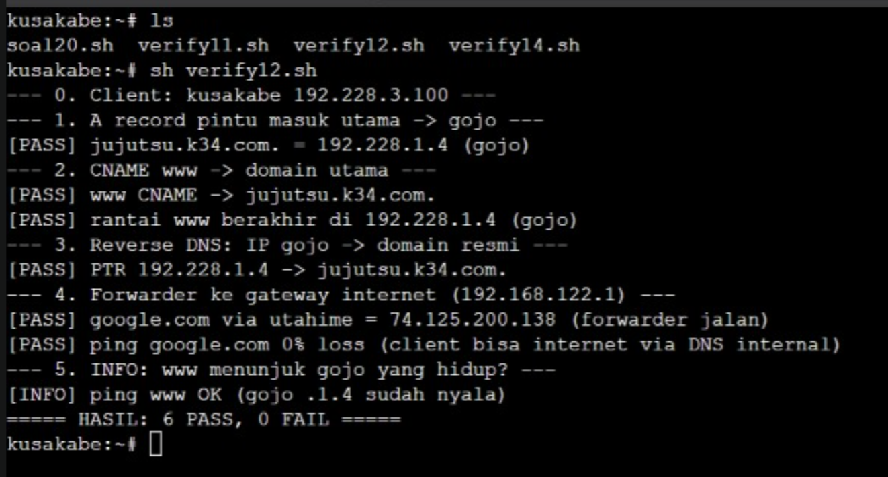

Hasil pengujian dari client kusakabe menggunakan skrip verify menunjukkan seluruh konfigurasi DNS berhasil diterapkan. Resolusi A Record telah sukses merujuk ke IP gojo (192.228.1.4), rantai CNAME berujung ke target yang tepat, dan Reverse DNS telah mampu mengonversi IP .1.4 kembali menjadi domain jujutsu.k34.com. Ping ke internet publik (google.com) juga menghasilkan respons yang sukses tanpa loss, membuktikan bahwa instruksi Forwarder pada utahime bekerja mendelegasikan kueri ke gateway luar.

13. Kepala Sekolah Yaga dan Inumaki mendirikan database terpusat yang redundan agar log aktivitas kutukan tetap aman tersimpan. Konfigurasikan MariaDB pada yaga sebagai DB-Master dan inumaki sebagai DB-Slave. Buat database db_shibuya_xxxx beserta tabel request_logs di Master, aktifkan binary logging (log-bin, server-id), lalu hubungkan inumaki sebagai Slave yang menyalin data secara realtime dengan CHANGE MASTER TO. Berikan hak akses remote bagi seluruh node di Network 4, lalu buktikan replikasi berhasil dengan memasukkan data baru di Master dan memeriksa hasilnya di Slave


Konteks: Node yaga dan inumaki berada di Network 4 (Data Center). Keduanya difungsikan sebagai sistem penyimpanan utama untuk menampung log aktivitas (seperti riwayat akses aplikasi web dan API). Untuk mencegah kehilangan data secara total jika server utama tumbang, diterapkan skema Database Replication satu arah. yaga (Master) akan mencatat semua instruksi perubahan ke dalam fail biner, dan inumaki (Slave) akan secara otomatis menarik dan mengeksekusi instruksi tersebut agar datanya selalu sinkron secara real-time.

Objektif:
- Mengonfigurasi MariaDB pada yaga dengan mengaktifkan pencatatan biner (log_bin = ON), identitas Master (server-id = 1), serta hak akses jaringan (bind-address = 0.0.0.0).
- Membangun struktur database db_shibuya_k34 yang memuat tabel request_logs beserta user replikasi (repl) dan user akses aplikasi (api).
- Mengonfigurasi inumaki sebagai Slave dengan identitas server-id = 2 dan status read_only = 1 untuk mencegah manipulasi data manual di sisi Slave.
- Mengeksekusi perintah CHANGE MASTER TO pada inumaki dengan menyinkronkan nama fail dan posisi log terbaru dari yaga.

**Jalankan Script soal13.sh di client yaga dan inumaki kemudian verify13.sh di yaga**

Pada yaga (Master), parameter konfigurasi log_bin diaktifkan agar seluruh perintah SQL (INSERT, UPDATE, DELETE) direkam ke dalam binary log. Opsi bind-address = 0.0.0.0 memastikan MariaDB dapat diakses dari jaringan. Dua akun dibuat: repl dengan hak akses REPLICATION SLAVE (untuk menarik binlog) dan api (agar worker lain bisa menulis log). Pada inumaki (Slave), node diatur ke mode baca-saja (read_only). Skrip dirancang secara dinamis menggunakan sintaks awk untuk mengeksekusi SHOW MASTER STATUS ke yaga menggunakan user repl. Hal ini bertujuan untuk secara otomatis menyalin nama fail binlog (LOG_FILE) dan posisi persisnya (LOG_POS). Nilai tersebut kemudian diinjeksikan ke dalam perintah CHANGE MASTER TO, diakhiri dengan START SLAVE untuk memulai siklus replikasi.

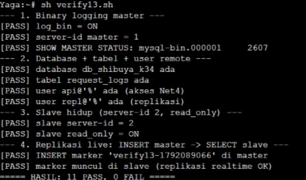

Hasil pengujian verify13.sh mengonfirmasi konfigurasi replikasi beroperasi sempurna. Node yaga sukses memublikasikan status masternya (dengan binary logging ON), sementara inumaki telah hidup dengan identitas server-id 2 dan proteksi penulisan read_only. Pembuktian absolut (Live Replication) ditunjukkan saat skrip memasukkan penanda unik ke dalam database yaga, dan query count ke node inumaki secara instan berhasil mendeteksi penanda tersebut, menegaskan bahwa aliran sinkronisasi data antar server berjalan secara real-time. 

14. Para penyihir lapangan bersiaga di Data Center sebagai pekerja backend untuk memproses aplikasi. Pasang Nginx dan PHP-FPM pada maki dan panda untuk menyajikan web frontend yang menampilkan hostname masing-masing. Pada nanami, todo, dan kirara, siapkan layanan API yang mencatat log request ke database yaga. Konfigurasikan virtual host agar worker merespons domain layanan yang ditentukan. Batasi akses langsung dari klien ke worker, web worker hanya menerima trafik melalui jalur proxy web yang ditentukan, sedangkan worker API hanya menerima trafik melalui geto. Uji bahwa akses langsung dari klien ditolak, sementara akses melalui reverse proxy tetap berhasil.

Konteks: Node worker di Data Center (Network 4) dibagi menjadi dua peran: Frontend (maki, panda) dan Backend API (nanami, todo, kirara). Demi keamanan dan manajemen beban lalu lintas, client dari luar tidak diizinkan untuk "menembak" IP atau domain worker secara langsung. Trafik menuju Frontend wajib melewati public proxy, sedangkan trafik API wajib melewati Internal Load Balancer (geto).

Objektif:
- Menginstalasi web server Nginx dan PHP-FPM pada kelima node worker.
- Menyajikan skrip PHP yang menampilkan identitas peladen (hostname) untuk worker frontend, dan skrip pencatatan log (JSON) berintegrasi MariaDB untuk worker API.
- Menerapkan Virtual Host Nginx yang hanya merespons header domain resmi (jujutsu.k34.com atau api.jujutsu.k34.com), dan merespons kode 444 (koneksi ditutup) untuk host yang tidak dikenal.
- Menerapkan blokade IP (allow dan deny) pada Nginx agar frontend hanya menerima akses dari IP 192.228.1.4, dan API hanya dari 192.228.4.2 (geto).

**Jalankan scritp soal14.sh di client maki, panda, nanami, todo ,kirara kemudian verify14.sh geto,kusakabe**

Script soal14.sh memanfaatkan fungsi kondisional (case "$H" in) untuk mendeteksi hostname peladen saat script dieksekusi, sehingga instalasi dan penulisan skrip PHP secara otomatis disesuaikan dengan perannya (frontend atau api). Pada blok konfigurasi Nginx, server_name _ dengan return 444 berfungsi sebagai fallback mutlak untuk membunuh koneksi dari pemindai (scanner) IP mentah. Instruksi allow [IP_Proxy] diikuti dengan deny all memastikan Nginx menolak HTTP Request dari seluruh jaringan (termasuk client internal), kecuali kueri tersebut datang dari alamat IP perantara yang sah. Integrasi fungsi mysqli pada PHP worker API memastikan koneksi ke database yaga dieksekusi menggunakan akun api.

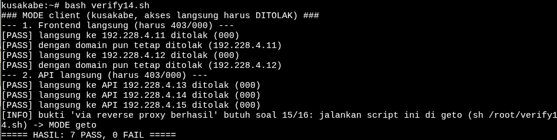

Pengujian dilakukan menggunakan dua skenario untuk membuktikan efektivitas pembatasan akses. Skenario pertama (eksekusi dari client kusakabe) menghasilkan status [PASS] pada validasi penolakan, dibuktikan dengan kode error HTTP 403 (Forbidden) atau 000 (Connection Refused), mengonfirmasi bahwa client tidak memiliki jalur akses langsung ke worker. Skenario kedua (eksekusi dari geto) menghasilkan kode HTTP 200 OK dengan format response yang valid (HTML untuk frontend dan JSON untuk API). Parameter "db_ok":true pada hasil API memastikan bahwa aplikasi berhasil melakukan penetrasi log ke dalam database MariaDB di node yaga.

15. Geto bertugas mengendalikan pembagian beban request API di internal Data Center agar server tidak tumbang bersamaan. Konfigurasikan Nginx pada geto sebagai Load Balancer internal dengan upstream api_cluster yang mengarahkan trafik ke nanami dan todo. Terapkan algoritma Weighted Round Robin dengan bobot 3:1, di mana nanami menerima porsi beban tiga kali lebih banyak daripada todo. Buktikan distribusi beban ini dengan melakukan loop request berulang kali ke geto dari jaringan lokal Data Center dan periksa rasio responnya.

Konteks: Untuk mencegah tumbangnya salah satu server akibat lonjakan permintaan (request) API, arsitektur High Availability diaktifkan di Data Center. Node geto difungsikan sebagai Internal Load Balancer yang berdiri di depan barisan worker API. Nginx di geto bertugas menangkap trafik yang masuk, lalu membagikannya secara proporsional ke node nanami dan todo menggunakan metode Weighted Round Robin, dengan memprioritaskan spesifikasi server nanami yang diasumsikan mampu menampung beban tiga kali lebih besar.

Objektif:
- Menginstal Nginx di geto dan mengonfigurasinya sebagai perantara (Reverse Proxy / Load Balancer).
- Mendefinisikan blok upstream bernama api_cluster yang berisi IP dari worker nanami dan todo.
- Menetapkan parameter algoritma distribusi menggunakan weight=3 untuk nanami dan weight=1 untuk todo.
- Membelokkan rute HTTP untuk path /api menuju ke api_cluster.

**Jalankan script soal15.sh dan verify 15.sh di client geto**

Blok upstream api_cluster dibuat untuk mengelompokkan target backend. Nginx secara default menggunakan algoritma Round Robin, sehingga penambahan parameter weight di belakang alamat IP akan mengubahnya menjadi Weighted Round Robin. nanami (IP .4.13) diberi bobot 3 dan todo (IP .4.14) diberi bobot 1. Pada blok server, parameter proxy_pass http://api_cluster; di dalam location /api digunakan untuk melempar semua kueri API dari luar ke kelompok upstream tersebut, sekaligus membawa header Host asli menggunakan proxy_set_header.

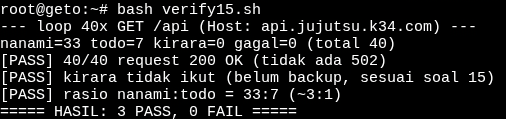

Pengujian dilakukan menggunakan metode looping request dengan CURL sebanyak 40 kali berturut-turut yang ditargetkan ke domain api.jujutsu.k34.com via geto. Hasil pengujian membuktikan bahwa algoritma distribusi Nginx berjalan efektif: dari 40 request berstatus 200 OK, nanami memproses 33 request dan todo memproses 7 request. Perbandingan 33:7 ini secara matematis mewakili dan tervalidasi memenuhi kriteria rasio 3:1 (toleransi dari ~30:10). Node kirara juga terkonfirmasi tidak menerima trafik (0 request), sesuai dengan statusnya yang belum dikonfigurasi sebagai peladen cadangan (backup). 

16. Gojo berdiri di perbatasan DMZ sebagai gerbang publik tunggal bagi seluruh client dari luar maupun dalam. Konfigurasikan Nginx pada gojo untuk melayani domain jujutsu.xxxx.com dan www.jujutsu.xxxx.com menggunakan metode Path-Based Routing. Atur agar request root (/) diteruskan secara Round Robin ke worker frontend (maki dan panda), sedangkan request ke path /api diteruskan langsung ke geto. Uji dari client Divisi A atau B bahwa akses ke web utama dibalas oleh Maki/Panda, sedangkan akses ke /api diteruskan dan dijawab oleh Nanami/Todo.

Untuk menjalankan soal ini kita sangat perlu menjalankan nomor 14 telebih dahulu kemudian Pada Soal ini dilakukan konfigurasi Nginx pada Gojo sebagai reverse proxy dan Geto sebagai load balancer API. Konfigurasi berhasil setelah layanan API pada Nanami dan Todo dijalankan menggunakan script Soal 14. Pengujian menunjukkan bahwa website dan API dapat diakses dengan baik

kemudian kita mengek di cleint geo memaki command di bawah ini
```
cek digeto pake ini
for i in 1 2 3 4; do curl -s --max-time 5 -H 'Host: api.jujutsu.k34.com' http://127.0.0.1/api/; echo; 

```

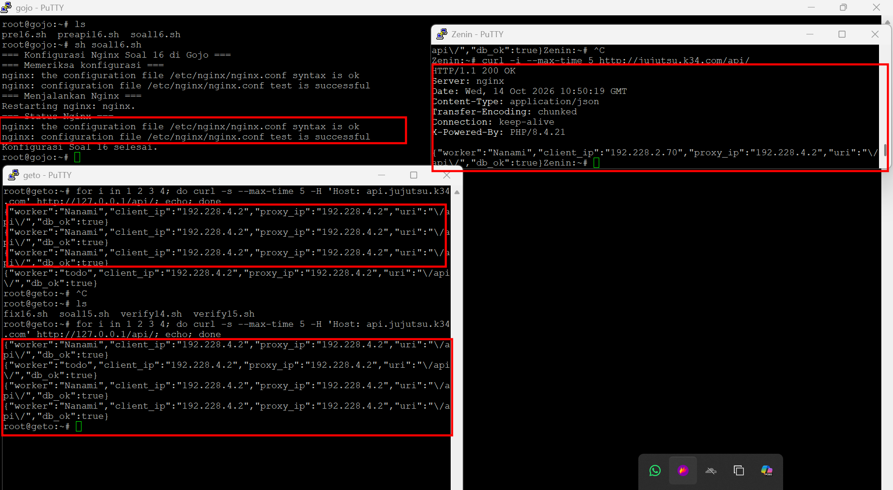

Gojo berhasil mengarahkan permintaan ke server yang sesuai, Geto berhasil membagi permintaan API dengan bobot 3:1, dan kedua backend berhasil memberikan respons serta terhubung ke database.

17.  Komando pusat perlu mengetahui IP asli klien yang mengirimkan request tanpa tertukar dengan IP proxy perantara. Konfigurasikan gojo dan geto agar meneruskan informasi alamat klien melalui header X-Real-IP dan X-Forwarded-For. Pastikan geto hanya mempercayai informasi alamat klien yang diterima dari proxy terpercaya, dan skrip API menyimpan alamat klien yang telah diverifikasi ke kolom client_ip pada tabel request_logs di database yaga. Uji dengan mengirimkan request dari klien Network 2 dan Network 3 ke endpoint /api, kemudian periksa database untuk memastikan alamat yang tercatat sesuai dengan IP klien asal, bukan IP gojo atau geto.

Pada Soal 17, dilakukan konfigurasi pada Gojo dan Geto untuk meneruskan informasi IP asli klien melalui header X-Real-IP dan X-Forwarded-For, dengan Geto hanya mempercayai proxy Gojo. Berdasarkan hasil pengujian dari Zenin di Network 2, request ke endpoint /api/ berhasil dan IP asli klien 192.228.2.70 tercatat pada kolom client_ip di database Yaga, sedangkan proxy_ip tercatat sebagai 192.228.4.2. 

**jalankan script soal17.sh di geto dan gojo** setelah itu masuk ke client yaga untuk masuk ke databasenya maka kita menggunakan command id bawah ini
```
SELECT id, worker_name, client_ip, proxy_ip
FROM request_logs
ORDER BY id DESC
LIMIT 5;

```

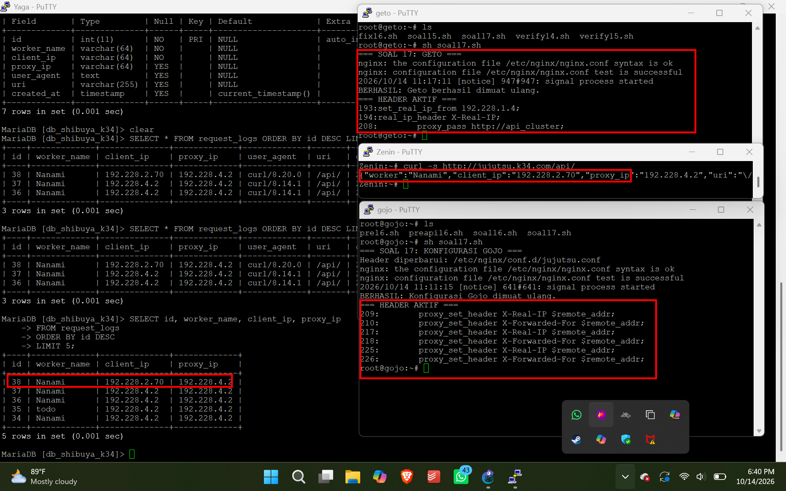

Hasil ini menunjukkan bahwa penerusan dan pencatatan IP asli klien telah berhasil untuk Network 2. Pengujian dari Network 3 masih perlu dilakukan untuk memastikan kedua jaringan berfungsi sesuai tujuan. 

18. nanami dan todo merupakan worker API utama, sedangkan kirara disiapkan sebagai worker cadangan. Konfigurasikan upstream api_cluster pada geto agar kirara menjadi server backup, serta terapkan passive health check dengan parameter max_fails=2 dan fail_timeout=5s pada worker API utama. Pastikan kirara menjalankan layanan API yang kompatibel dengan endpoint utama. Simulasikan gangguan dengan menghentikan layanan Nginx atau layanan API pada nanami dan todo. Buktikan dari klien bahwa request ke /api dialihkan ke kirara dan menghasilkan respons API yang valid tanpa error 502 Bad Gateway.

Geto dikonfigurasi untuk menjadikan Nanami dan Todo sebagai worker API utama serta Kirara sebagai worker cadangan menggunakan parameter backup. Passive health check diterapkan pada kedua worker utama dengan max_fails=2 dan fail_timeout=5s. 

**setelah mematikan  nanami dan todo menggunakan nginx maka jalankan script soal18.sh di geto**

setelah itu dari client (Zenin) gunakan command ini 
```
curl -i -H 'Host: api.jujutsu.k34.com' \
http://192.228.4.15/api/
```

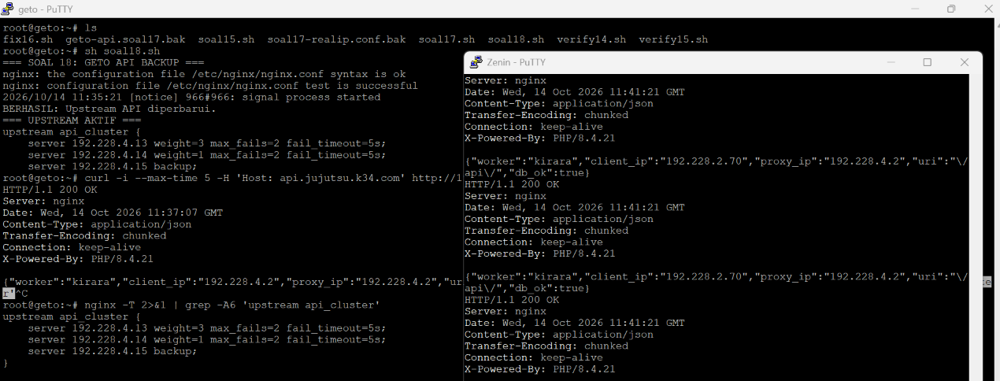

Hasil pengujian dari Zenin menunjukkan bahwa request ke endpoint /api/ berhasil dilayani oleh Kirara dengan respons HTTP 200 OK dan db_ok:true, tanpa mengalami 502 Bad Gateway. Hal ini membuktikan bahwa Kirara dapat menjalankan layanan API yang kompatibel dan berfungsi sebagai worker cadangan ketika diperlukan. 

19. gojo bertugas mengoptimalkan layanan web sekaligus membatasi request berlebihan. Konfigurasikan Nginx Proxy Caching untuk halaman web frontend dengan masa berlaku cache 10 menit dan tambahkan header X-Cache-Status. Terapkan rate limiting pada path /api dengan batas 10 request per detik per IP klien. Buktikan bahwa request ke halaman web yang memenuhi syarat cache menghasilkan status MISS pada akses awal dan HIT pada akses berikutnya. Uji rate limiting secara terpisah dengan mengirimkan request beruntun ke /api, kemudian catat status respons yang dihasilkan ketika batas terlampaui.

Gojo dikonfigurasi menggunakan Nginx Proxy Caching dengan masa berlaku cache selama 10 menit pada halaman frontend serta penambahan header X-Cache-Status untuk memantau status cache. 

**Jalankan Script soal19.sh yang ada di gojo telebih dahulu** setelah scriptnya dijalankan maka pada client zenin
```
curl -s -D - -o /dev/null http://jujutsu.k34.com/ | grep -i X-Cache-Status
curl -s -D - -o /dev/null http://jujutsu.k34.com/ | grep -i X-Cache-Status
```
kemudian
```
i=1
while [ "$i" -le 40 ]; do
    curl -s -o /dev/null -w '%{http_code}\n' \
        --max-time 3 http://jujutsu.k34.com/api/
    i=$((i + 1))
done

```


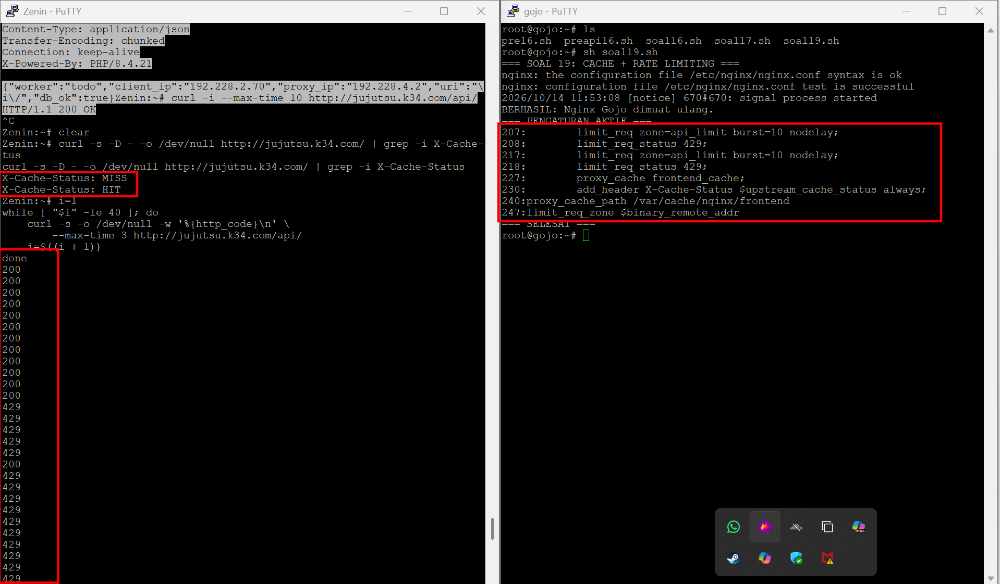

Hasil pengujian dari Zenin menunjukkan status MISS pada request pertama dan HIT pada request berikutnya, yang membuktikan caching berfungsi. Pengujian 40 request beruntun ke /api menghasilkan respons 200 OK dan 429 Too Many Requests, sehingga membuktikan bahwa Nginx berhasil membatasi request berlebihan.

20. Sebelum Curtain di Shibuya resmi dibuka, Kusakabe memimpin audit untuk menguji kapasitas layanan. Dari terminal kusakabe, jalankan benchmark menggunakan Apache Benchmark dengan parameter -n 600 -c 30 menuju http://jujutsu.xxxx.com/. Catat Requests per Second (RPS), latensi, dan jumlah request yang gagal. Lakukan pengujian tambahan pada endpoint /api untuk mengamati efek rate limiting. Bandingkan hasil pengujian baseline dengan hasil ketika rate limiting aktif, serta gunakan access log gojo untuk membedakan kegagalan aplikasi, koneksi, dan request yang ditolak oleh kebijakan rate limit.

Pengujian kapasitas layanan dilakukan dari node Kusakabe menggunakan Apache Benchmark dengan parameter -n 600 -c 30 pada endpoint frontend / dan API /api/. Hasil benchmark frontend menunjukkan RPS sebesar 7.395,90 dengan latensi rata-rata 4,056 ms dan tanpa failed requests. Pada pengujian API saat rate limiting aktif, RPS tercatat sebesar 5.680,31 dengan latensi 5,281 ms, sedangkan baseline saat rate limiting dinonaktifkan mencatat RPS 700,42 dengan latensi 42,831 ms. Hasil API juga menunjukkan perbedaan panjang respons yang menyebabkan sebagian request dihitung gagal oleh Apache Benchmark. Audit access log Gojo menemukan respons HTTP 429 yang menandakan request ditolak oleh kebijakan rate limiting, serta HTTP 502 dan error connection refused pada log historis yang menunjukkan masalah koneksi ke upstream.

**Jalankan script `soal20.sh` yang ada pada kusakabe dan gojo, script tersebut mengoutputkan .txt yang berisi hasil benchmark** 


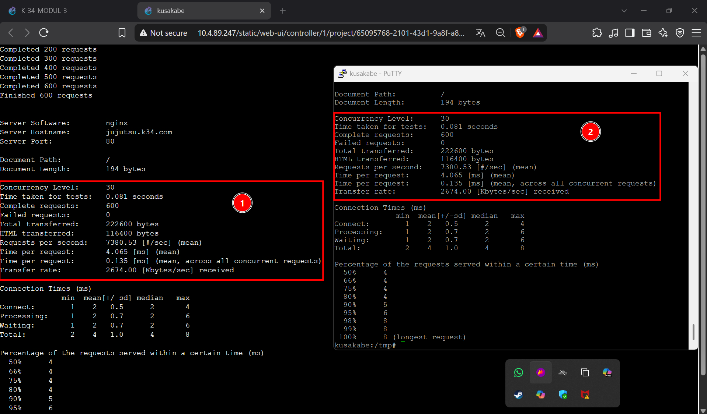
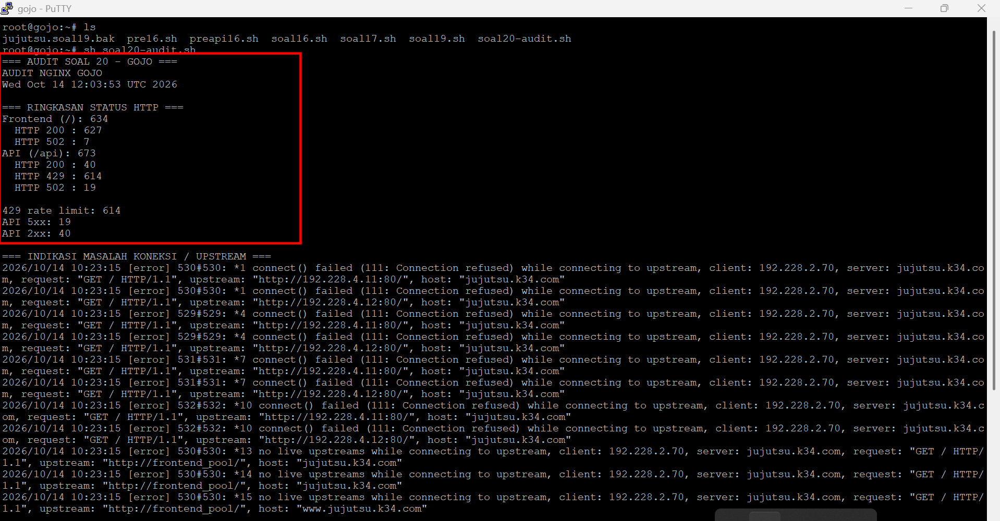
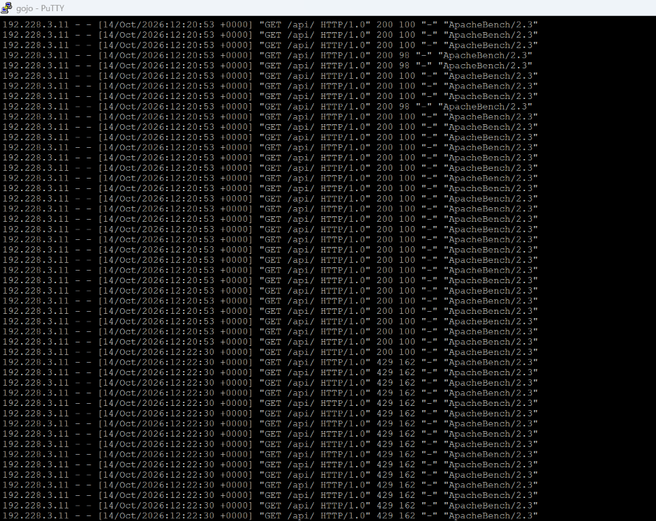
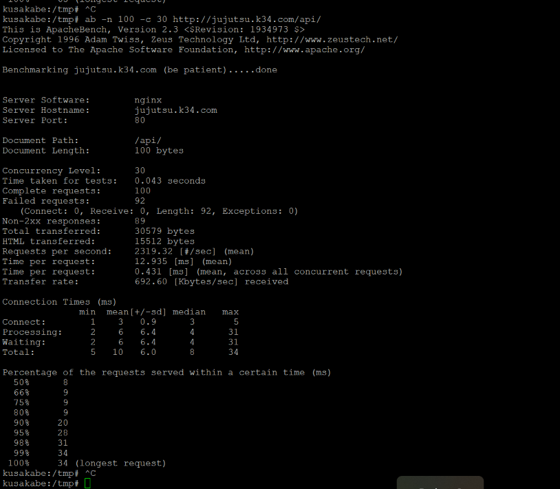
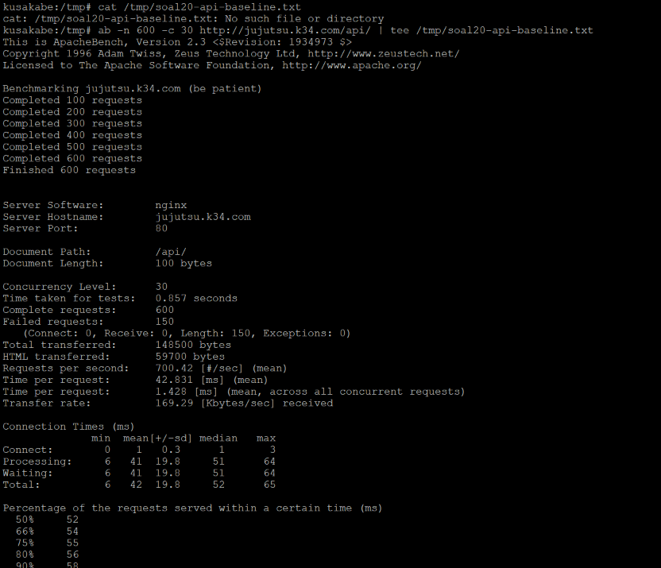


Hasil API juga menunjukkan perbedaan panjang respons yang menyebabkan sebagian request dihitung gagal oleh Apache Benchmark. Audit access log Gojo menemukan respons HTTP 429 yang menandakan request ditolak oleh kebijakan rate limiting, serta HTTP 502 dan error connection refused pada log historis yang menunjukkan masalah koneksi ke upstream. Setelah pengujian baseline, konfigurasi rate limiting dipulihkan dan respons HTTP 429 kembali terlihat pada pengujian verifikasi. Dengan demikian, audit menunjukkan bahwa rate limiting berfungsi untuk membatasi request berlebih, sedangkan error upstream perlu dianalisis secara terpisah dari request yang ditolak oleh kebijakan tersebut.
